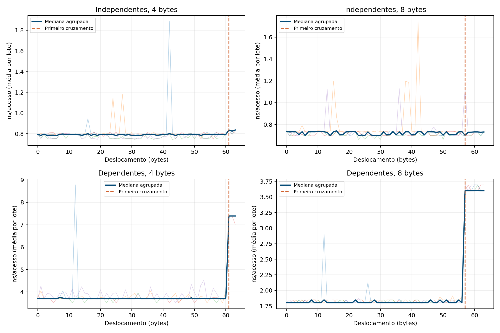
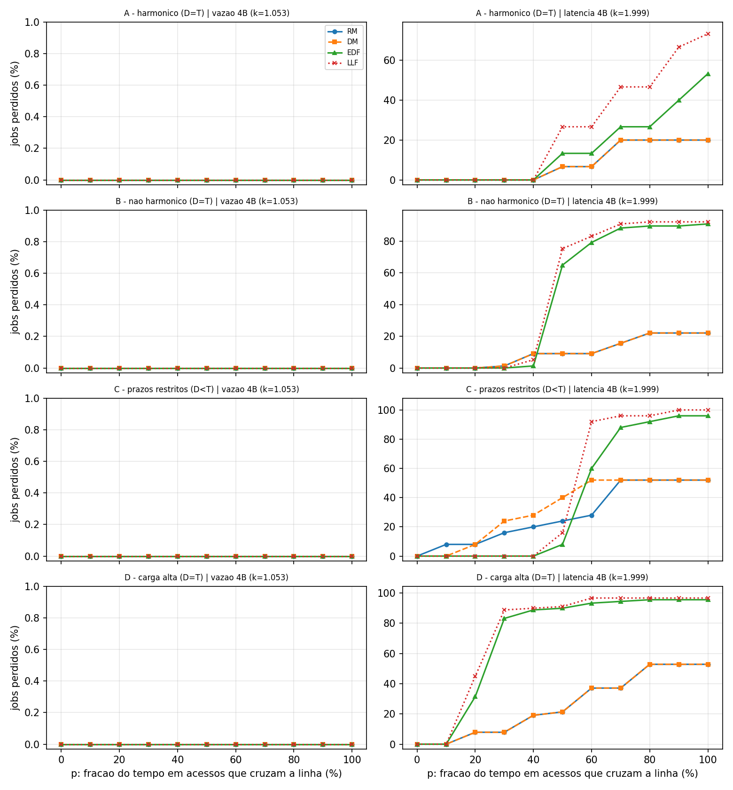

<div align="center">

# Memory Alignment & Real-Time Systems

### Acessos desalinhados à memória, desempenho e escalonabilidade

**Alexsand Farias de Souza · Wesley Vitorino Teixeira**

Programa de Pós-Graduação em Engenharia Elétrica (PPGEE)  
Universidade Federal do Amazonas (UFAM) · Manaus, Amazonas, Brasil

**Disciplina:** Sistemas de Tempo Real  
**Professor responsável:** Prof. Dr. Lucas Cordeiro

[Visão geral](#visão-geral) · [Resultados](#principais-resultados) · [Reprodução](#como-reproduzir) · [Artigo](#artigo-e-artefatos) · [English](#english-summary)

</div>

## Visão geral

Este repositório reúne os artefatos do projeto acadêmico-científico **“Impacto dos Acessos Desalinhados à Memória no Tempo de Execução e na Escalonabilidade de Sistemas de Tempo Real”**.

O estudo combina benchmarks em C, medições em Linux nativo e simulações em Python para investigar quando leituras desalinhadas alteram o tempo de execução e como esses custos podem afetar tarefas periódicas sob **RM, DM, EDF e LLF**.

A campanha nativa utiliza um Intel Core i5-8265U. A campanha anterior, descrita no artigo, utilizou Intel Core i5-12450H sob WSL2. **Como os processadores são diferentes, a comparação não isola o efeito da virtualização.**

> Os valores são tempos observados e projeções de um modelo de sensibilidade. Máximos observados, medianas e percentis não constituem garantias de WCET (*Worst-Case Execution Time*).

## Pergunta de pesquisa

Como o custo de acessos desalinhados à memória, especialmente daqueles que cruzam uma linha de cache, afeta o tempo observado de execução e, sob um modelo explícito, a utilização, os tempos de resposta e o cumprimento de prazos em sistemas de tempo real?

## Objetivos

1. Implementar benchmarks que evitem acesso por ponteiros tipados com alinhamento incompatível.
2. Caracterizar o ambiente e verificar as instruções produzidas pelo compilador.
3. Comparar leituras independentes e dependentes, com larguras de 4 e 8 bytes.
4. Examinar medianas, p99, máximos observados e variação entre rodadas.
5. Aplicar fatores de custo medidos à análise por simulação de quatro políticas de escalonamento.
6. Documentar dados, procedimentos e limitações para permitir reprodução.

## Conceitos investigados

**Desalinhamento natural e cruzamento de linha são condições diferentes.** Uma leitura pode começar em endereço incompatível com o alinhamento natural do tipo e ainda permanecer dentro da mesma linha de cache.

Para uma linha de 64 bytes, uma leitura de largura `s`, iniciada no deslocamento `o`, cruza a linha quando:

```text
o + s > 64
```

| Largura | Deslocamentos sem cruzamento | Deslocamentos com cruzamento |
|---|---|---|
| 4 bytes | 0 a 60 | 61 a 63 |
| 8 bytes | 0 a 56 | 57 a 63 |

## Desenho experimental

| Aspecto | Leituras independentes | Cadeia de leituras dependentes |
|---|---|---|
| Código | `analysis_input/bench_align.c` | `analysis_input/bench_chain.c` |
| Relação entre endereços | Próximo endereço não depende do valor lido | Índice lido forma o próximo endereço |
| Foco | Vazão do laço | Custo por salto dependente |
| Área nominal | 16 KiB | 16 KiB |
| Alocação | Alinhada a 64 B, com 64 B de folga | Mesma estratégia |
| Aquecimento por offset | 50 passadas | 20 percursos |
| Trabalho por amostra | 200 × 256 = 51.200 leituras | 50 × 256 = 12.800 saltos |
| Rodadas por largura | 5 | 5 |
| Amostras por offset/rodada | 1.000 | 1.000 |
| Deslocamentos | 0 a 63, embaralhados com semente fixa | Mesma estratégia de ordem |

A reprodução nativa contém **20 CSVs e 1.280.000 amostras**. Cada amostra é o tempo de um lote dividido pelo número de acessos; inclui cálculo de endereço e controle de laço. **Não é uma medição isolada de cada instrução de carga.**

O tempo é obtido com `CLOCK_MONOTONIC_RAW`. As leituras e escritas de construção da cadeia utilizam `memcpy` de tamanho fixo. A inspeção de assembly confirmou cargas escalares e a preservação das dependências no trecho medido.

## Plataforma Linux nativa

| Item | Registro da campanha |
|---|---|
| Equipamento | Dell Latitude 3400 |
| Processador | Intel Core i5-8265U |
| Topologia | 4 núcleos físicos, 8 CPUs lógicas |
| Sistema | Ubuntu 26.04 LTS, x86_64 |
| Kernel | 7.0.0-42-generic, PREEMPT_DYNAMIC |
| Linha de cache | 64 bytes |
| L1 de dados | 32 KiB por núcleo |
| GCC | 15.2.0 |
| Opções | `-O2 -std=c11 -Wall -Wextra` |
| Afinidade nos comandos de coleta | CPU lógica 2 |
| Governor registrado | `powersave`, consultado na CPU 0 |
| Detecção de virtualização | `none` |
| Sessões | 16 e 17 de novembro de 2026 |

O governor da CPU 2 e a atividade da thread SMT irmã não foram registrados continuamente. PREEMPT_DYNAMIC não comprova PREEMPT_RT. Capacidade suficiente da L1 não demonstra que todas as cargas foram atendidas nesse nível.

## Principais resultados

Medianas agrupadas de todas as amostras das classes **não cruza** e **cruza**:

| Cenário | Largura | Não cruza (ns/acesso) | Cruza (ns/acesso) | Fator `k` | Variação |
|---|---:|---:|---:|---:|---:|
| Independentes | 4 B | 0,7923 | 0,8340 | 1,0526 | +5,26% |
| Independentes | 8 B | 0,7321 | 0,7302 | 0,9974 | −0,26% |
| Dependentes | 4 B | 3,6959 | 7,3879 | 1,9989 | +99,89% |
| Dependentes | 8 B | 1,8009 | 3,6003 | 1,9992 | +99,92% |

**Interpretação:** nas cadeias dependentes, o custo normalizado por salto praticamente dobrou ao cruzar a linha. Nas leituras independentes de 4 bytes, a penalidade foi menor; nas de 8 bytes, não foi demonstrada penalidade consistente. O fator ligeiramente inferior a 1 não comprova ganho causal de desempenho.



As linhas finas representam medianas por rodada; a linha destacada representa a mediana das 5.000 amostras por offset. A linha tracejada indica o primeiro offset com cruzamento.

### Definições estatísticas

- **Mediana por classe:** todas as amostras dos offsets pertencentes à classe.
- **Fator de custo:** `k = mediana(cruza) / mediana(não cruza)`.
- **Faixa entre rodadas:** menor e maior `k` calculado separadamente por rodada.
- **Indicador p99:** primeiro o percentil 99 por par rodada-offset, com interpolação linear; depois a mediana desses percentis em cada classe.
- **Fator k p99:** razão entre os dois agregados anteriores; não é um p99 global nem pWCET.
- **Máximo observado:** maior valor registrado, preservado sem exclusão automática de extremos.

As definições e tabelas completas estão no artigo e nos CSVs de análise.

## Modelo de custo e escalonabilidade

O modelo de sensibilidade aplicado às tarefas é:

```text
C_i(p, k) = C_i × [1 + p × (k − 1)]
```

`C_i` é o tempo-base da tarefa, `p` é a fração desse tempo-base atribuída aos acessos afetados e `k` é o fator medido. `p` não foi medido em programas reais.

| Política | Critério principal |
|---|---|
| RM - Rate Monotonic | Menor período, prioridade fixa |
| DM - Deadline Monotonic | Menor prazo relativo, prioridade fixa |
| EDF - Earliest Deadline First | Menor prazo absoluto, prioridade dinâmica |
| LLF - Least Laxity First | Menor folga, prioridade dinâmica |

O simulador considera um processador, preempção, liberações síncronas, `D ≤ T`, horizonte de um hiperperíodo e tick de **0,01 ms**. Os custos são arredondados para cima. Jobs atrasados continuam executando; não há custo de troca de contexto. O CSV distingue utilização modelada e utilização efetiva após quantização.

### Conjuntos sintéticos

Cada tripla representa `(C, T, D)`, em milissegundos.

| Conjunto | Tarefas | Utilização-base | Hiperperíodo |
|---|---|---:|---:|
| A - Harmônico | `(2,10,10)`, `(4,20,20)`, `(8,40,40)`, `(8,80,80)` | 0,7000 | 80 ms |
| B - Não harmônico | `(2,10,10)`, `(3,14,14)`, `(5,35,35)`, `(8,50,50)` | 0,7171 | 350 ms |
| C - Prazos restritos | `(4,10,10)`, `(2,20,16)`, `(4,30,15)`, `(1,40,24)` | 0,6583 | 120 ms |
| D - Carga alta | `(3,10,10)`, `(4,15,15)`, `(5,35,35)`, `(9,60,60)` | 0,8595 | 420 ms |

### Resultados da simulação

Foram executadas **1.408 combinações** da grade: quatro conjuntos, oito fatores, onze valores de `p` e quatro políticas. Os oito fatores incluem medianas e indicadores p99 de ambas as larguras e formas de acesso.

- Com os fatores de leituras independentes, não houve perda de prazo nos quatro conjuntos até `p = 100%`.
- Com fatores medianos das cadeias, a primeira perda surgiu entre aproximadamente `p = 7%` e `p = 43%`, conforme conjunto e política.
- Os testes originais do simulador passaram; 36 comparações adicionais de RM, DM e EDF com uma implementação independente passo a passo concordaram em perdas e respostas máximas.

| Conjunto | Política | Primeiro p com perda, cadeia 4 B | Primeiro p com perda, cadeia 8 B |
|---|---|---:|---:|
| A | RM, DM, EDF, LLF | 43,0% | 43,0% |
| B | RM, DM | 25,2% | 25,2% |
| B | EDF, LLF | 39,5% | 39,5% |
| C | RM | 7,0% | 7,0% |
| C | DM | 14,5% | 14,5% |
| C | EDF, LLF | 43,0% | 43,0% |
| D | RM, DM | 13,1% | 13,1% |
| D | EDF, LLF | 16,4% | 16,4% |

A busca por bisseção usa tolerância de **0,002 em p**, equivalente a 0,2 ponto percentual. A apresentação com uma casa decimal não implica resolução de 0,1 ponto percentual. São limiares no modelo e horizonte simulados, não certificações de sistemas reais.



## Estrutura dos arquivos

A estrutura abaixo corresponde aos caminhos reais do pacote de reprodução.

| Caminho | Conteúdo |
|---|---|
| `README.md` | Apresentação científica e guia de reprodução |
| `CITATION.cff` | Metadados de autoria e citação do projeto |
| `requirements.txt` | Dependências Python da análise e geração do artigo |
| `analysis_input/` | CSVs e logs brutos, ambiente, fontes C e assembly recebido |
| `entrega/analisar_resultados.py` | Validação dos CSVs e análise estatística |
| `entrega/fatores_custo.csv` | Fatores agrupados das quatro configurações |
| `entrega/estatisticas_completas.csv` | Estatísticas por rodada e deslocamento |
| `entrega/medianas_deslocamento.png` | Gráfico dos benchmarks |
| `final/Artigo_Linux_Nativo_Atualizado.docx` | Artigo editável |
| `final/Artigo_Linux_Nativo_Atualizado.pdf` | Artigo para leitura |
| `final/codigo/` | Simuladores originais e scripts de integração |
| `final/tabelas/` | Resultados, respostas, fatores e validações da simulação |
| `final/figuras/` | Gráficos de perdas e respostas |
| `final/LEIAME.md` | Notas adicionais de reprodução |

## Como reproduzir

### 1. Obter o projeto e preparar o Python

```bash
git clone https://github.com/alexsandsouza/memory-alignment-realtime.git
cd memory-alignment-realtime
python3 -m venv .venv
source .venv/bin/activate
python -m pip install -r requirements.txt
```

O fluxo usa `pandas`, `matplotlib` e `python-docx`. As versões não estão fixadas; isso permite instalação, mas não garante um ambiente idêntico ao da análise original.

### 2. Reanalisar os dados existentes

```bash
python entrega/analisar_resultados.py
python final/codigo/executar_simulacao.py
```

O primeiro script valida e recalcula os indicadores a partir dos CSVs brutos. O segundo executa a validação e as simulações com os fatores nativos, fornecidos explicitamente em precisão integral, sem utilizar os padrões WSL2 embutidos no simulador.

Esses comandos **recalculam os arquivos de saída** das respectivas pastas. Preserve uma cópia antes de experimentar alterações. Eles não repetem os benchmarks no seu computador.

### 3. Gerar o artigo editável

```bash
python final/codigo/gerar_artigo.py
```

O comando produz o DOCX a partir dos resultados e figuras. Para gerar um PDF, exporte o documento no Word ou LibreOffice. Se alterar os dados ou a metodologia, revise também os trechos narrativos do script: o texto do artigo não é integralmente calculado de forma automática.

### 4. Realizar novas medições em Linux nativo

Para uma nova campanha, escolha uma CPU lógica presente na afinidade permitida por `taskset -pc $$`, confira o tamanho da linha de cache e registre seu ambiente. Os comandos abaixo usam CPU lógica 2, como na campanha original; ajuste se ela não estiver disponível.

```bash
getconf LEVEL1_DCACHE_LINESIZE
taskset -pc $$
mkdir -p novas_coletas
cd novas_coletas

gcc -O2 -std=c11 -Wall -Wextra \
  -o bench_align_4 ../analysis_input/bench_align.c
gcc -O2 -std=c11 -Wall -Wextra -DACCESS_BYTES=8 \
  -o bench_align_8 ../analysis_input/bench_align.c
gcc -O2 -std=c11 -Wall -Wextra \
  -o bench_chain_4 ../analysis_input/bench_chain.c
gcc -O2 -std=c11 -Wall -Wextra -DACCESS_BYTES=8 \
  -o bench_chain_8 ../analysis_input/bench_chain.c
```

Registre o novo ambiente antes da execução:

```bash
{
  date --iso-8601=seconds
  uname -a
  cat /etc/os-release
  lscpu
  gcc --version
  getconf LEVEL1_DCACHE_LINESIZE
  taskset -pc $$
  cat /sys/devices/system/cpu/cpu2/cpufreq/scaling_governor
  cat /sys/devices/system/cpu/cpu2/topology/thread_siblings_list
  systemd-detect-virt
} > ambiente.txt 2>&1
```

Inspecione o laço medido, não apenas a ausência de chamadas a `memcpy`:

```bash
objdump -d --no-show-raw-insn --disassemble=main bench_align_4 > assembly_align4.txt
objdump -d --no-show-raw-insn --disassemble=main bench_align_8 > assembly_align8.txt
objdump -d --no-show-raw-insn --disassemble=main bench_chain_4 > assembly_chain4.txt
objdump -d --no-show-raw-insn --disassemble=main bench_chain_8 > assembly_chain8.txt
```

Exemplo de uma rodada por configuração:

```bash
taskset -c 2 ./bench_align_4 > dados4_run1.csv 2> dados4_run1.log
taskset -c 2 ./bench_align_8 > dados8_run1.csv 2> dados8_run1.log
taskset -c 2 ./bench_chain_4 > cadeia4_run1.csv 2> cadeia4_run1.log
taskset -c 2 ./bench_chain_8 > cadeia8_run1.csv 2> cadeia8_run1.log
```

Repita cinco vezes com sufixos `run1` a `run5`, preservando as campanhas anteriores. Cada CSV deve conter **64.001 linhas**, incluindo cabeçalho. Para analisar a nova campanha, adapte o caminho `SRC` de `entrega/analisar_resultados.py` em uma cópia do projeto; ele aponta, por padrão, para `analysis_input/`.

Não misture medições novas com os CSVs publicados sem identificar plataforma, data, compilação e condições. Para comparações causais entre Linux nativo e WSL2, use o mesmo hardware e controle o protocolo.

## Artigo e artefatos

- [Artigo atualizado - Word editável](final/Artigo_Linux_Nativo_Atualizado.docx)
- [Artigo atualizado - PDF](final/Artigo_Linux_Nativo_Atualizado.pdf)
- [Fatores de custo](entrega/fatores_custo.csv)
- [Simulações completas](final/tabelas/simulacao.csv)
- [Limiares de perda de prazo](final/tabelas/p_critico.csv)
- [Respostas por tarefa](final/tabelas/respostas.csv)
- [Registro de validação](final/tabelas/validacao.json)

As referências bibliográficas utilizadas estão no artigo. Os dados brutos WSL2 não integram esta campanha nativa; a comparação histórica usa os resultados documentados no texto original.

## Limitações e interpretação responsável

- Estudo em uma plataforma nativa e uma plataforma WSL2 diferente; sem isolamento do efeito do sistema operacional.
- Somente leituras, buffer nominal de 16 KiB e larguras de 4 e 8 bytes.
- Sem controle contínuo de frequência, temperatura, interferência ou atividade SMT.
- Ordem dos offsets embaralhada, porém fixa entre rodadas.
- Sem contadores para confirmar todos os acessos na L1 ou atribuir causalmente os picos.
- Medianas e p99 representam distribuições de tempos normalizados por lote.
- Fração `p` hipotética, tarefas sintéticas e ausência de custo de troca de contexto.
- Respostas de jobs incompletos no horizonte são limites inferiores, sinalizados por `resp_ge=True` no CSV.
- Vazão e cadeia são cenários de acesso, não limites matemáticos garantidos para programas arbitrários.

## Próximas etapas de pesquisa

- [ ] Variar a semente da ordem de medição entre rodadas.
- [ ] Registrar frequência e temperatura durante a execução.
- [ ] Comparar Linux nativo e WSL2 no mesmo processador.
- [ ] Investigar escritas, buffers maiores e cruzamento de páginas.
- [ ] Medir `p` em aplicações reais e incluir custos de preempção.

## Autoria e contexto acadêmico

| Participante | Identificação |
|---|---|
| **Alexsand Farias de Souza** | Coautor · PPGEE/UFAM · [GitHub](https://github.com/alexsandsouza) · alexsand.farias@ufam.edu.br |
| **Wesley Vitorino Teixeira** | Coautor · PPGEE/UFAM · wesley.vitorino@ufam.edu.br |
| **Prof. Dr. Lucas Cordeiro** | Professor responsável pela disciplina de Sistemas de Tempo Real |

O professor é identificado pelo contexto da disciplina; a autoria deste projeto é de **Alexsand Farias de Souza e Wesley Vitorino Teixeira**.

## Como citar

Enquanto não houver DOI ou registro de publicação, cite este projeto como artefato de pesquisa e registre o commit consultado:

> SOUZA, Alexsand Farias de; TEIXEIRA, Wesley Vitorino. *Memory Alignment & Real-Time Systems: benchmarks e análise de escalonabilidade*. Repositório de pesquisa, PPGEE/UFAM, 2026. Disponível em: https://github.com/alexsandsouza/memory-alignment-realtime. Informar a data de acesso e o commit utilizado.

Os metadados estruturados estão em [`CITATION.cff`](CITATION.cff). Esta citação não indica publicação revisada por pares.

## Contribuições e licença

Discussões sobre reprodução, análise estatística e validação podem ser registradas nas [issues](https://github.com/alexsandsouza/memory-alignment-realtime/issues). Ao propor mudanças, informe ambiente, commit, comando executado e resultados esperados e observados.

Uma licença de redistribuição ainda não foi definida pelos autores. A disponibilidade pública dos arquivos não equivale à concessão automática de uma licença de software, dados ou texto acadêmico.

## English summary

**Memory Alignment & Real-Time Systems** is an academic research project by **Alexsand Farias de Souza and Wesley Vitorino Teixeira**, developed within the Electrical Engineering Graduate Program at the Federal University of Amazonas (PPGEE/UFAM), for the Real-Time Systems course taught by **Prof. Dr. Lucas Cordeiro**.

The native Linux campaign contains **20 CSV files and 1,280,000 samples**, covering independent reads and dependent pointer-chasing with 4-byte and 8-byte accesses. Crossing a 64-byte cache line approximately doubled the normalized time per dependent hop. Independent 4-byte reads showed a smaller effect; independent 8-byte reads did not show a consistent penalty.

Measured factors feed a sensitivity model and **1,408 simulated combinations** of task sets, cost factors, affected-time fractions and RM/DM/EDF/LLF policies. These simulations are projections, not executions of the periodic workloads on the measurement laptop. Observed maxima and percentile ratios are not guaranteed WCET bounds.

The previous WSL2 campaign used a different processor, so the comparison cannot isolate virtualization overhead. See the Portuguese sections above for exact methods, limitations, repository paths and reproduction commands. Both authors are credited in [`CITATION.cff`](CITATION.cff).
